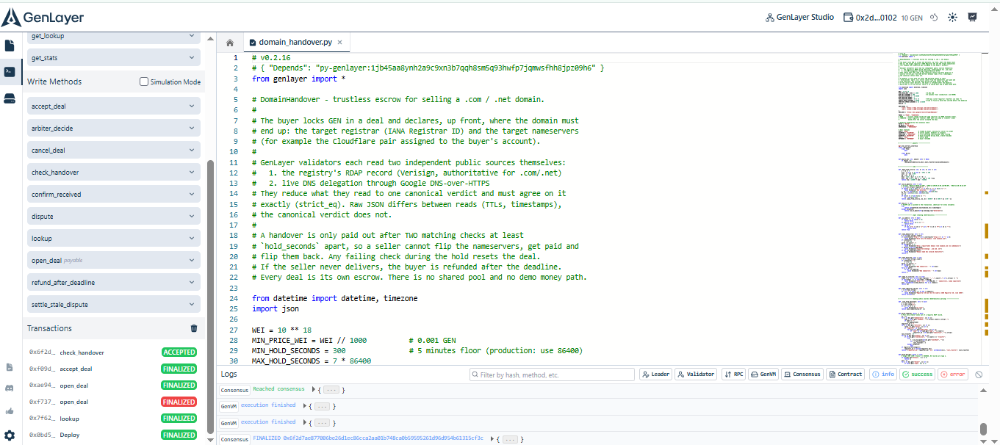
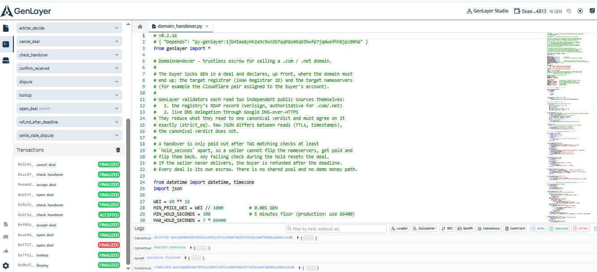

# DomainHandover — trustless escrow for domain sales on GenLayer

Selling a domain between strangers has a trust problem. If the buyer pays first, the seller can keep the domain. If the seller hands it over first, the buyer can disappear. Today people pay escrow services 3–10% to sit in the middle.

DomainHandover replaces that middleman with a GenLayer Intelligent Contract. The buyer locks GEN. The seller is paid only when GenLayer validators **independently read public internet records** and agree that the domain really moved to the buyer.

## Live on GenLayer Studio

The contract is deployed at [`0x612F61Bc5258dCD8957fc94d7671CecC7edF24f5`](https://explorer-studio.genlayer.com/address/0x612F61Bc5258dCD8957fc94d7671CecC7edF24f5). These results come from real web data, read by validators on Nov 20, 2026:

| Test | Result |
|---|---|
| `lookup("example.com")` | registrar_id `376`; RDAP NS and live DNS NS both `elliott.ns.cloudflare.com`, `hera.ns.cloudflare.com` |
| Deal #0 (PUSH, correct target, hold 300 s) | check 1 `MATCH` → `VERIFYING`; check 2 `MATCH` 341 s later → **`PAID`**, 1 GEN sent to the seller |
| Deal #1 (wrong target NS) | `NO_MATCH`, reasons: "registry nameservers do not match target", "live DNS nameservers do not match target"; status stays `ACCEPTED`, nothing paid |
| Deal #1 `cancel_deal` by seller | **`REFUNDED`**, 1 GEN back to the buyer |





Raw `get_deal(0)` history after payout:

```
OPEN by buyer -> ACCEPTED by seller -> first MATCH, hold started -> PAID to seller: two matching checks 341s apart
```

## How it works

1. **Buyer opens a deal** (`open_deal`, payable). The buyer states the exact end state:
   - the **target registrar** (numeric IANA Registrar ID), and
   - the **target nameservers** (for example the Cloudflare pair assigned to the buyer's own account).
2. **Seller reads the terms and accepts** (`accept_deal`). Nothing is hidden.
3. The seller moves the domain, then the buyer or seller calls **`check_handover`**.
4. Validators read **two independent sources**:
   - the **registry RDAP record** (Verisign, authoritative for `.com` / `.net`): registrar ID, delegated nameservers, transfer events
   - **live DNS delegation** through Google DNS-over-HTTPS
5. **First match** → the deal goes to `VERIFYING` and a hold timer starts.
6. **A second match at least `hold_seconds` later** → the seller is paid automatically.
7. **Any failed check during the hold resets it.** A seller cannot flip the nameservers, get paid, and flip them back.
8. **No handover by the deadline** → the buyer calls `refund_after_deadline`.

### Two handover modes

| Mode | Real-world case | Extra rule |
|---|---|---|
| `PUSH` | The account changes inside the same registrar (GoDaddy/Namecheap "push") | registrar ID + nameservers must match |
| `TRANSFER` | Inter-registrar transfer to the buyer's registrar | RDAP must also show a `transfer` event dated **after** the seller accepted |

## How GenLayer consensus is used

All the web reading happens in `_consensus_state()` inside `gl.eq_principle.strict_eq`.

Raw responses are **not** compared, because TTLs and timestamps differ between reads. Each validator reduces what it read to a small **canonical state**:

```json
{"registrar_id": "1068", "rdap_ns": ["ada.ns.cloudflare.com","bob.ns.cloudflare.com"],
 "dns_ns": ["ada.ns.cloudflare.com","bob.ns.cloudflare.com"], "last_transfer": 1763890000}
```

Honest validators produce byte-identical JSON, so `strict_eq` is the right equivalence check.

- The verdict (`MATCH` / `NO_MATCH` / `UNREADABLE`) is then computed by a **pure deterministic function** (`decide`) from the agreed state and the deal terms.
- **No LLM is used.** Ownership is a fact question, not an opinion, so an LLM would only add risk.
- **During DNS propagation** some resolvers can briefly disagree. Validators then fail to reach consensus, the transaction does not apply and nothing changes. You simply check again later.
- **If a source is down**, the verdict is `UNREADABLE` and the deal state is not changed.

## Why it is a reusable primitive

- `parse_rdap`, `parse_dns`, `read_state` and `decide` are a self-contained **"verified domain state"** module. Any GenLayer contract that needs to know who controls a domain can reuse it: domain-gated airdrops, website-ownership proofs, brand protection, DAO domain custody.
- `lookup(domain)` stores a validator-agreed snapshot of the current registrar and nameservers on-chain. Buyers use it to fill in a deal, and other contracts can use it as a cheap oracle read.
- **Isolated per-deal escrow:** every deal holds only its own buyer's money. There is no shared pool, no demo money path, and money is conserved (`escrow + paid + refunded = deposits`; this is checked in the tests).

## Safety rules in the contract

- Only `.com` and `.net` (Verisign RDAP), registrable domains only. No subdomains or URLs, so no URL injection.
- **One active deal per domain.**
- **Hold:** 5 min minimum, 7 days maximum. Use 24 h in production; the 5-minute floor exists so the flow can be tested in Studio.
- **Deadline:** 1 hour to 60 days. If a hold started before the deadline, it gets 24 h of grace to finish.
- **Optional arbiter:** a third address named at open. The seller sees it before accepting. Only the buyer can dispute, and only during the hold. If the arbiter is silent for 14 days, the public evidence (two matches) stands and the seller is paid.
- **Cancel rules:** the buyer can cancel before acceptance. The seller can decline at any time before payout, and this always refunds the buyer. The buyer can release early with `confirm_received`.

## Known limits (honest threat model)

- **Public records cannot show the registrant** (GDPR redaction). The contract proves where the domain is delegated and at which registrar, not the name of the account holder. Targeting the buyer's own Cloudflare nameserver pair plus a registrar transfer makes faking this very costly for a seller. The optional arbiter covers the rest.
- **TLDs are limited** to `.com` and `.net`. Other TLDs can be added by adding their RDAP base URL.

## Public methods

| Method | Who | What |
|---|---|---|
| `lookup(domain)` | anyone | store the validator-agreed current registrar + nameservers |
| `open_deal(domain, seller, mode, target_registrar_id, target_nameservers, deadline_hours, hold_seconds, arbiter)` payable | buyer | lock the price |
| `accept_deal(id)` | seller | agree to the terms |
| `check_handover(id)` | buyer / seller | validators read RDAP + DNS |
| `confirm_received(id)` | buyer | pay the seller early |
| `cancel_deal(id)` | buyer (before accept) / seller | refund the buyer |
| `refund_after_deadline(id)` | buyer | refund if not delivered |
| `dispute(id, reason)` / `arbiter_decide(id, release)` / `settle_stale_dispute(id)` | buyer / arbiter / both | optional arbiter flow |
| `get_deal`, `get_lookup`, `get_stats` | view | read state (JSON) |

## Tests

```
python3 tests/test_domain_handover.py
```

There are 46 offline tests. They use a stubbed `genlayer` module so the real contract file runs unchanged. They cover:

- the happy path, a hold too short, and a nameserver flip-back that resets the hold
- the registry and live DNS disagreeing, a wrong registrar, and sources being down
- the deadline refund, and TRANSFER mode with an old vs a fresh transfer event
- disputes and the arbiter, all cancel paths, and money conservation

The Studio test steps are in `STUDIO_TEST.md`.
