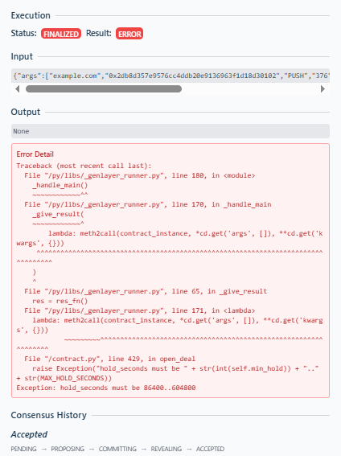

# DomainHandover — trustless escrow for domain sales on GenLayer

Selling a domain between strangers has a trust problem. If the buyer pays first, the seller can keep the domain. If the seller hands it over first, the buyer can disappear. Today people pay escrow services to sit in the middle.

DomainHandover replaces that middleman with a GenLayer Intelligent Contract. The buyer locks GEN. The seller is paid only when GenLayer validators **independently read public internet records** and agree that the domain really moved to the buyer.

## Live on GenLayer Studio

The same source file is deployed twice:

| Contract | Address |
|---|---|
| **Live** (`test_mode = false`) | [`0xE22ab63b03c0EB21d50F1A009fdb6A3B8f098Ab6`](https://explorer-studio.genlayer.com/address/0xE22ab63b03c0EB21d50F1A009fdb6A3B8f098Ab6) |
| **Test** (`test_mode = true`) | [`0xE17cB31aE37B63953D5ED822A9089e892421fdd3`](https://explorer-studio.genlayer.com/address/0xE17cB31aE37B63953D5ED822A9089e892421fdd3) |

These results come from real web data, read by validators on Nov 20, 2026. The test contract was used with `example.com`, whose current setup was the "target" (see Known limits).

| Test | Result |
|---|---|
| `lookup("example.com")` | registrar_id `376`; RDAP NS and live DNS NS both `elliott.ns.cloudflare.com`, `hera.ns.cloudflare.com` |
| Deal #0 `accept_deal` | baseline recorded by validators; logged as "test mode: already on target" |
| Deal #0 check 1 | `MATCH` → `VERIFYING` |
| Deal #0 check 2 (416 s later) | `MATCH` → `RETAINED`; **0.8 GEN** paid to the seller, 0.2 GEN locked |
| Deal #0 `retention_check` after retention | `MATCH` → **`PAID`**; the last **0.2 GEN** paid to the seller |
| Deal #1 (wrong target NS) | `NO_MATCH`: "registry nameservers do not match target", "live DNS nameservers do not match target" |
| Deal #1 `cancel_deal` by seller | **`REFUNDED`**, 1 GEN back to the buyer |
| **Live** contract `open_deal` with a 300 s hold | **refused**: `hold_seconds must be 86400..604800` |

Deal #0 history (from `get_deal(0)`):

```
OPEN by buyer
ACCEPTED by seller (test mode: already on target)
first MATCH, hold started
PAID 800000000000000000 wei to seller: two matching checks 416s apart (retention started)
PAID 200000000000000000 wei to seller: retention ended, domain still on target
```



## How it works

1. **Buyer opens a deal** (`open_deal`, payable). The buyer states the exact end state:
   - the **target registrar** (numeric IANA Registrar ID), and
   - the **target nameservers** (for example the Cloudflare pair assigned to the buyer's own account).
2. **Seller reads the terms and accepts** (`accept_deal`). Nothing is hidden.
3. The seller moves the domain, then the buyer or seller calls **`check_handover`**.
4. Validators read **two independent sources**:
   - the **registry RDAP record** (Verisign, authoritative for `.com` / `.net`): registrar ID, delegated nameservers, transfer events
   - **live DNS delegation** through Google DNS-over-HTTPS
5. **First match** → the deal goes to `VERIFYING` and a hold timer starts.
6. **A second match at least `hold_seconds` later** → **80%** of the price goes to the seller automatically.
7. **Any failed check during the hold resets it.** A seller cannot flip the nameservers, get paid, and flip them back.
8. **Retention.** The other **20%** stays locked for `retention_seconds`. At acceptance, validators recorded the seller's **original setup** (baseline registrar + nameservers). During retention, the buyer can call `retention_check` at any time.
   - If the domain is back on the seller's original nameservers, or (in TRANSFER mode) back at the seller's original registrar → `REVERTED`, and the retained 20% returns to the buyer at once (`CLAWED_BACK`).
   - When retention ends and the domain is still on target, the seller collects the last 20%.
   - If the setup changed to something that is neither the target nor the seller's original, it cannot be blamed on either side. It goes to the arbiter if one was named; otherwise it is released to the seller. This way a buyer cannot steal the 20% by moving the domain to a new host.
9. **No handover by the deadline** → the buyer calls `refund_after_deadline`.

### Two handover modes

| Mode | Real-world case | Extra rule |
|---|---|---|
| `PUSH` | The account changes inside the same registrar (GoDaddy/Namecheap "push") | registrar ID + nameservers must match |
| `TRANSFER` | Inter-registrar transfer to the buyer's registrar | RDAP must also show a `transfer` event dated **after** the seller accepted |

## How GenLayer consensus is used

All the web reading happens in `_consensus_state()` inside `gl.eq_principle.strict_eq`.

Raw responses are **not** compared, because TTLs and timestamps differ between reads. Each validator reduces what it read to a small **canonical state**:

```json
{"registrar_id": "1068", "rdap_ns": ["ada.ns.cloudflare.com","bob.ns.cloudflare.com"],
 "dns_ns": ["ada.ns.cloudflare.com","bob.ns.cloudflare.com"], "last_transfer": 1763890000}
```

Honest validators produce byte-identical JSON, so `strict_eq` is the right equivalence check.

- The verdict (`MATCH` / `NO_MATCH` / `UNREADABLE`) is then computed by a **pure deterministic function** (`decide`) from the agreed state and the deal terms.
- **No LLM is used.** Ownership is a fact question, not an opinion, so an LLM would only add risk.
- **During DNS propagation** some resolvers can briefly disagree. Validators then fail to reach consensus, the transaction does not apply and nothing changes. You simply check again later.
- **If a source is down**, the verdict is `UNREADABLE` and the deal state is not changed.

## Why it is a reusable primitive

- `parse_rdap`, `parse_dns`, `read_state` and `decide` are a self-contained **"verified domain state"** module. Any GenLayer contract that needs to know who controls a domain can reuse it: domain-gated airdrops, website-ownership proofs, brand protection, DAO domain custody.
- `lookup(domain)` stores a validator-agreed snapshot of the current registrar and nameservers on-chain. Buyers use it to fill in a deal, and other contracts can use it as a cheap oracle read.
- **Isolated per-deal escrow:** every deal holds only its own buyer's money. There is no shared pool, no demo money path, and money is conserved (`escrow + paid + refunded = deposits`; this is checked in the tests).

## Safety rules in the contract

- Only `.com` and `.net` (Verisign RDAP), registrable domains only. No subdomains or URLs, so no URL injection.
- **One active deal per domain.**
- **Live vs test contract.** The constructor takes `test_mode`.
  - **Live contract** (`test_mode = false`): hold of at least 24 h, retention of at least 7 days, and `accept_deal` refuses a domain that is already on the target setup (there would be nothing to hand over).
  - **Test contract** (`test_mode = true`): 5-minute floors and allows an already-on-target domain, so the whole flow can be shown in Studio with a public domain.
  - Every deal is a separate escrow with no shared pool, so a test contract can never pay out anyone else's money.
- **Deadline:** 1 hour to 60 days. If a hold started before the deadline, it gets 24 h of grace to finish.
- **Optional arbiter:** a third address named at open. The seller sees it before accepting. Only the buyer can dispute, and only during the hold. If the arbiter is silent for 14 days, the public evidence (two matches) stands and the seller is paid.
- **Cancel rules:** the buyer can cancel before acceptance. The seller can decline at any time before payout, and this always refunds the buyer. The buyer can release early with `confirm_received`.

## Known limits (honest threat model)

- **Public records cannot show the registrant** (GDPR redaction). The contract proves where the domain is delegated and at which registrar, not the name of the account holder.
- **What protects the buyer:**
  - the target is the buyer's own Cloudflare nameserver pair, plus a fresh registrar transfer in TRANSFER mode
  - the hold, the 20% retention with revert detection, and the optional arbiter
- **What is left:** a seller who keeps control in PUSH mode and waits past the retention period still keeps the domain. In that case the buyer has lost 80%. For high-value sales, use TRANSFER mode, a longer retention and an arbiter.
- **Buyer duty:** the buyer agrees to keep the target setup until retention ends. Moving to a new host during retention is safe, because it counts as `CHANGED`, not `REVERTED`.
- **About the Studio demo:** it uses `example.com`, whose current setup is used as the "target", because a real handover needs a domain the tester owns. The live contract refuses that case. The revert, clawback and arbiter paths are covered by the offline tests.
- **TLDs are limited** to `.com` and `.net`. Other TLDs can be added by adding their RDAP base URL.

## Public methods

| Method | Who | What |
|---|---|---|
| `lookup(domain)` | anyone | store the validator-agreed current registrar + nameservers |
| `open_deal(domain, seller, mode, target_registrar_id, target_nameservers, deadline_hours, hold_seconds, retention_seconds, arbiter)` payable | buyer | lock the price |
| `accept_deal(id)` | seller | agree to the terms; validators record the baseline |
| `check_handover(id)` | buyer / seller | validators read RDAP + DNS |
| `retention_check(id)` | buyer (any time) / seller (after retention) | validators re-read; revert → 20% back to buyer, still on target → 20% to seller |
| `confirm_received(id)` | buyer | pay the seller early |
| `cancel_deal(id)` | buyer (before accept) / seller | refund the buyer |
| `refund_after_deadline(id)` | buyer | refund if not delivered |
| `dispute(id, reason)` / `arbiter_decide(id, release)` / `settle_stale_dispute(id)` | buyer / arbiter / both | optional arbiter flow |
| `get_deal`, `get_lookup`, `get_stats` | view | read state (JSON) |

## Tests

```
python3 tests/test_domain_handover.py
```

There are 63 offline tests. They use a stubbed `genlayer` module so the real contract file runs unchanged. They cover:

- the live/test floors, and a domain already on target refused on the live contract
- the happy path with an 80/20 split, and a flip-back during the hold that resets it
- a seller revert after payout that claws back the 20%
- a buyer move to a new host that cannot steal the 20%
- a TRANSFER revert to the original registrar
- the registry and live DNS disagreeing, a wrong registrar, and sources being down
- the deadline refund, the arbiter for the full price and for the retained part, all cancel paths, and money conservation

The Studio test steps are in `STUDIO_TEST.md`.
